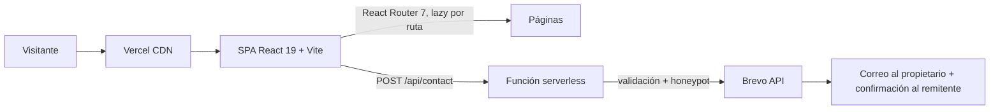

# Luis Crisanto · Portafolio

Portafolio de **Luis Crisanto**, desarrollador Full Stack con enfoque en cloud y visión por computadora.
Está en producción: **https://luis-crisanto.vercel.app**


## Para reclutadores (30 segundos)

| Qué mirar | Dónde |
|---|---|
| Sitio en vivo | https://luis-crisanto.vercel.app |
| Proyecto más sólido | [RetailVision Analytics](https://github.com/lcrisantosi7-cris/retailvision-analytics): detección de personas en tiempo real con YOLOv8 y FastAPI |
| Sistema en producción | [AlfaPet](https://alfapet.vercel.app/): gestión de clínica veterinaria (MVC, POO, ISO 25010) |
| CV | [`public/cv-luis-crisanto.pdf`](public/cv-luis-crisanto.pdf) |
| Contacto | lcrisantosi7@gmail.com · [LinkedIn](https://www.linkedin.com/in/luis-crisanto-silupú) |

## Qué demuestra este proyecto

- **Frontend:** SPA en React 19 con rutas por carga diferida, animación con Framer Motion y scroll suave con Lenis.
- **UX/UI:** sistema de diseño propio con tokens (colores, tipografía, color por sección), modo liviano para móvil y datos limitados, y respeto a `prefers-reduced-motion`.
- **Accesibilidad:** enlace "saltar al contenido", etiquetas ARIA, foco gestionado al navegar y formulario con errores anunciados.
- **Backend:** función serverless en Vercel (`/api/contact`) con validación en servidor, campo trampa anti-bots y envío de correo transaccional con Brevo.
- **Arquitectura:** datos de proyectos y stack en un único archivo (`src/data/techData.js`) que alimenta tarjetas, expedientes y métricas.

## Arquitectura



## Decisiones de diseño e ingeniería

| Decisión | Por qué |
|---|---|
| Modo liviano (`src/lib/lite.js`) | En táctil, pantallas chicas, `prefers-reduced-motion` o ahorro de datos se desactivan parallax, scroll suave y cursor. |
| Una sola fuente de datos | Agregar un proyecto es editar un objeto; la tarjeta y el expediente se generan solos. |
| Expedientes por proyecto | Cada proyecto muestra problema, solución, métricas y tres capas (diseño, código y arquitectura). |
| Sonido sintetizado | Los efectos se generan con WebAudio: cero archivos de audio y apagado por defecto en móvil. |
| Rutas en español + redirecciones | URLs legibles (`/proyectos/alfapet`) sin romper enlaces antiguos. |

## Estructura

```
api/contact.js        Función serverless del formulario
public/               Imágenes, CV, sitemap y robots
src/
  components/         Header, Footer, Layers, Spotlight, cursor, transición de página
  data/techData.js    Proyectos y stack (fuente única)
  lib/                Canales, modo liviano, sonido
  pages/              Inicio, Sobre mí, Experiencia, Proyectos, Expediente, Servicios, Contacto
```

## Ejecutar en local

```bash
npm install
npm run dev
```

Para probar el formulario necesitas la variable `BREVO_API_KEY` en `.env.local` y ejecutar con `vercel dev`.

| Script | Acción |
|---|---|
| `npm run dev` | Servidor de desarrollo |
| `npm run build` | Build de producción |
| `npm run lint` | ESLint |

## Proyectos destacados

- **RetailVision Analytics** (en desarrollo): visión por computadora, FastAPI, WebSocket y React. [Repo](https://github.com/lcrisantosi7-cris/retailvision-analytics)
- **AlfaPet** (producción): sistema veterinario con Supabase. [Demo](https://alfapet.vercel.app/) · [Repo](https://github.com/lcrisantosi7-cris/AlfaPet)
- **PlantMilk** (concepto): ecommerce de marca con Shopify, GSAP y Three.js. [Demo](https://plantmilk.lovable.app) · [Repo](https://github.com/lcrisantosi7-cris/plantmilk)

---

Hecho por [Luis Crisanto](https://luis-crisanto.vercel.app).